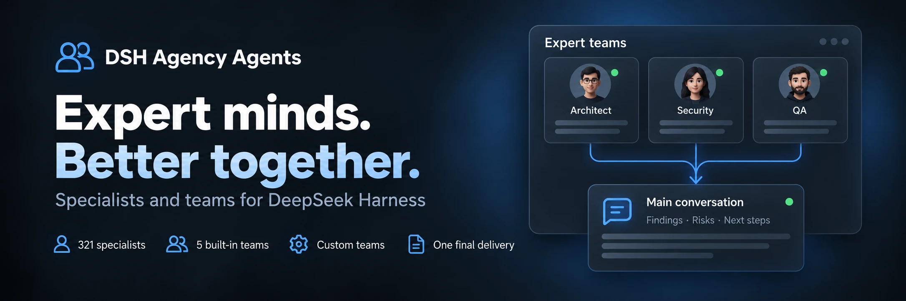

<div align="center">
  
</div>

<div align="center">

  # DSH Agency Agents

  **331 Fachexperten · 5 integrierte Teams · Benutzerdefinierte Zusammenarbeit**

  [简体中文](README.zh-CN.md) · [English](README.en.md) · [日本語](README.ja.md) · [Español](README.es.md) · [Français](README.fr.md) · [Deutsch](README.de.md) · [Русский](README.ru.md) · [Português](README.pt.md)

  [Expertenliste](#experten-kategorien-22-divisions) · [Installation](#schnellinstallation) · [Änderungsprotokoll](CHANGELOG.md) · [Apache-2.0](LICENSE)

  [](LICENSE)
  [](#experten-kategorien-22-divisions)
  [](https://www.npmjs.com/package/@michengai/dsh-agency-agents)
  [](https://www.npmjs.com/package/@michengai/dsh-agency-agents)
  [](https://github.com/MichengAI/dsh-agency-agents)
  [](https://github.com/MichengAI/dsh-agency-agents)

</div>

> **Haftungsausschluss**: DSH Agency Agents ist ein von der Community gepflegtes Plugin für DeepSeek Harness (DSH) und kein offizielles DeepSeek AI-Produkt.

## Funktionsübersicht

Wählen Sie bei Code-Reviews, Design, Betrieb oder Recherchen einen passenden Experten in DSH, der Sie professionell unterstützt. 331 Experten sind integriert und sofort einsatzbereit.

- **Multi-Surface & breites Layout**: Verwaltung über **Einstellungen → Experten** oder dauerhafter Seitenleistenzugang mit zentrierter 960px-Vollansicht.
- **Erstellung im Dialog mit KI (Create with AI)**: Dialogbasierte Erstellung mit automatischer Weiterleitung zum Hauptchat und Prompt-Vorausfüllung. Strukturierte Vorschau und Bestätigung über native Ask-Karten (Human-in-the-Loop).
- **Intelligente Stapelaktionen (Batch Actions)**: Kompaktes Dropdown-Menü in der Filterleiste mit dynamischer Verknüpfung: „Gefilterte aktivieren (N) / deaktivieren (M)“ und „Alle aktivieren (331) / deaktivieren“ mit atomarer Ausführung.
- **Vollständiger Katalog aus 331 Domänenexperten**: 22 Standardkategorien (Entwicklung, Produkt, Design, Marketing, Recht etc.) mit sofortiger Präfixsuche.
- **Multidisziplinäre Teams (Teams)**: 5 leistungsstarke integrierte Review-Teams und Unterstützung für bis zu 100 benutzerdefinierte Teams in paralleler oder sequenzieller Ausführung.
- **Schneller Aufruf im Composer**: Experten oder Teams über das `@`-Kürzel oder die Roboter-Schaltfläche direkt mit Aufgabenbeispielen aufrufen.
- **Enterprise-Konfiguration & Sicherheit**: Konfigurieren Sie Zugangsorte und intelligente Empfehlungen; Same-Origin-Schutz aktiv.
- **Nahtlose Reverse-Proxy-Kompatibilität**: Automatische Auflösung der Basis-URL (`document.baseURI`) für reibungslosen Betrieb hinter Pfad-Präfix-Proxies.

## Expertenteams (Expert Teams)

Verwalten Sie Teams unter „Einstellungen → Experten → Expertenteams“ mit gemeinsamen Headern, Filtern und Suchen. Die 5 Teams decken folgende Szenarien ab:

| Expertenteam | Analyseschwerpunkt | Ergebnisse |
| --- | --- | --- |
| Produkt-Review-Team | Nutzen, Benutzererlebnis, technische Machbarkeit | Prioritäten und Maßnahmenliste |
| Technisches Review-Team | Architektur, Sicherheit, Abnahmekriterien | Risiken und Checkliste |
| Content-Planungs-Team | Themenansätze, Distributionsstrategie, Faktencheck | Redaktionsplan und Struktur |
| Datenanalyse-Team | Kennzahlen, Datenqualität, geschäftliche Interpretation | Erkenntnisse und Validierungsschritte |
| Forschungsteam | Untersuchungsbereich, Belege, Gesamtsynthese | Fundierte Forschungsergebnisse mit Quellen |

### Konfiguration und Nutzung

1. Integrierte Teams direkt nutzen oder duplizieren. Eigene Teams mit 2 bis 8 Mitgliedern erstellen (bis zu 100 speicherbar).
2. Wählen Sie ein Team mit `@` im Eingabefeld, um Aufgabenbeispiele vor dem Absenden einzufügen und anzupassen.
3. Wenn der Host Agent Team unterstützt, wird automatisch der native parallele Kooperationsmodus verwendet.

## Schnellinstallation

```bash
# Web Profile
dsh plugin --profile web add @michengai/dsh-agency-agents

# Desktop Profile
dsh plugin --profile desktop add @michengai/dsh-agency-agents
```

## Experten-Kategorien (22 Divisions)


| Division | Key | Count |
| --- | --- | --- |
| Engineering | `engineering` | 64 |
| Marketing | `marketing` | 27 |
| Design | `design` | 22 |
| Product | `product` | 21 |
| Sales | `sales` | 19 |
| Healthcare | `healthcare` | 18 |
| Finance | `finance` | 16 |
| Specialized | `specialized` | 16 |
| Academic | `academic` | 14 |
| Research | `research` | 14 |
| Legal | `legal` | 13 |
| Support | `support` | 12 |
| Testing | `testing` | 11 |
| Project Management | `project-management` | 11 |
| Game Development | `game-development` | 11 |
| Spatial Computing | `spatial-computing` | 10 |
| Company Leadership | `company` | 9 |
| Human Resources | `hr` | 8 |
| Security | `security` | 8 |
| Supply Chain | `supply-chain` | 8 |
| Paid Media | `paid-media` | 6 |
| GIS | `gis` | 3 |


## License

[Apache-2.0](LICENSE) © [MichengAI](https://github.com/MichengAI)
