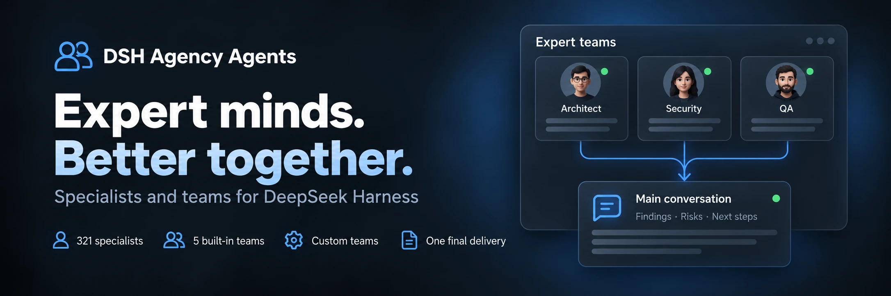

<div align="center">
  
</div>

<div align="center">

  # DSH Agency Agents

  **331 especialistas · 5 equipos integrados · Colaboración personalizada**

  [简体中文](README.zh-CN.md) · [English](README.en.md) · [日本語](README.ja.md) · [Español](README.es.md) · [Français](README.fr.md) · [Deutsch](README.de.md) · [Русский](README.ru.md) · [Português](README.pt.md)

  [Lista de expertos](#divisiones-de-expertos-22-divisions) · [Instalación](#instalación-rápida) · [Historial de cambios](CHANGELOG.md) · [Apache-2.0](LICENSE)

  [](LICENSE)
  [](#divisiones-de-expertos-22-divisions)
  [](https://www.npmjs.com/package/@michengai/dsh-agency-agents)
  [](https://www.npmjs.com/package/@michengai/dsh-agency-agents)
  [](https://github.com/MichengAI/dsh-agency-agents)
  [](https://github.com/MichengAI/dsh-agency-agents)

</div>

> **Descargo de responsabilidad**: DSH Agency Agents es un complemento mantenido por la comunidad para DeepSeek Harness (DSH), no es un producto oficial de DeepSeek AI.

## Descripción general

Cuando enfrente tareas de revisión de código, diseño, operaciones o investigación, elija un especialista adecuado en DSH para que le ayude profesionalmente. Incluye 331 expertos listos para usar tras la instalación.

- **Acceso multisurface y diseño amplio**: Gestione desde **Configuración → Expertos** o active la entrada fija en la barra lateral para abrir en un panel centrado dedicado de 960px sin límites de desplazamiento.
- **Creación mediante IA (Create with AI)**: Flujo de creación dual con salto directo al chat principal y prellenado de prompts. Previsualizaciones en Markdown estructurado con ajuste en múltiples turnos y confirmación nativa Ask (Human-in-the-Loop).
- **Acciones inteligentes por lotes**: Menú compacto en la barra de filtros vinculado dinámicamente: «Habilitar filtrados (N) / Deshabilitar filtrados (M)» y «Habilitar todos (331) / Deshabilitar todos», con confirmación y ejecución atómica.
- **Catálogo completo de 331 expertos de dominio**: Cubre 22 divisiones estándar (ingeniería, producto, diseño, marketing, legal, etc.) con búsqueda instantánea.
- **Colaboración en equipo multirrol (Teams)**: 5 equipos integrados de alto impacto y soporte para hasta 100 equipos personalizados con ejecución paralela o relevo.
- **Invocación rápida en el editor**: Convoque especialistas o equipos mediante `@` o el botón de robot junto al campo de entrada.
- **Control empresarial y seguridad**: Configure ubicaciones de entrada y sugerencias inteligentes; compatible con `updater: false` para bloquear endpoints de actualización con protección de solo lectura a nivel de plataforma; validación estricta de origen.
- **Compatibilidad con proxies inversos**: Resolución automática de URL base (`document.baseURI`) para operar detrás de proxies que eliminan prefijos de ruta.

## Equipos de expertos (Expert Teams)

Gestione equipos en «Configuración → Expertos → Equipos de expertos», compartiendo encabezado, filtros y búsqueda. Los cinco equipos cubren los siguientes escenarios:

| Equipo de expertos | Enfoque de análisis | Livrables |
| --- | --- | --- |
| Equipo de revisión de producto | Valor de requisitos, experiencia de usuario, viabilidad técnica | Prioridades y lista de acciones |
| Equipo de revisión técnica | Arquitectura, seguridad, límites de aceptación | Riesgos y lista de verificación |
| Equipo de planificación de contenidos | Ángulo editorial, estrategia de difusión, verificación de hechos | Propuesta editorial y estructura |
| Equipo de diagnóstico y análisis de datos | Métricas, calidad de datos, interpretación de negocio | Conclusiones y pasos de validación |
| Equipo de investigación especializada | Alcance, evidencias, juicio sintético | Conclusiones respaldadas con fuentes |

### Configuración y uso

1. Use un equipo integrado directamente o cópielo para personalizarlo. Cree equipos de 2 a 8 miembros (hasta 100 guardados).
2. Seleccione un equipo con `@` en el editor para insertar automáticamente ejemplos de tareas antes de enviar.
3. Si el host tiene habilitado Agent Team, se aplicará automáticamente el modo de colaboración nativo.

## Instalación rápida

```bash
# Web Profile
dsh plugin --profile web add @michengai/dsh-agency-agents

# Desktop Profile
dsh plugin --profile desktop add @michengai/dsh-agency-agents
```

## Divisiones de expertos (22 Divisions)


| Division | Key | Count |
| --- | --- | --- |
| Engineering | `engineering` | 64 |
| Marketing | `marketing` | 27 |
| Design | `design` | 22 |
| Product | `product` | 21 |
| Sales | `sales` | 19 |
| Healthcare | `healthcare` | 18 |
| Finance | `finance` | 16 |
| Specialized | `specialized` | 16 |
| Academic | `academic` | 14 |
| Research | `research` | 14 |
| Legal | `legal` | 13 |
| Support | `support` | 12 |
| Testing | `testing` | 11 |
| Project Management | `project-management` | 11 |
| Game Development | `game-development` | 11 |
| Spatial Computing | `spatial-computing` | 10 |
| Company Leadership | `company` | 9 |
| Human Resources | `hr` | 8 |
| Security | `security` | 8 |
| Supply Chain | `supply-chain` | 8 |
| Paid Media | `paid-media` | 6 |
| GIS | `gis` | 3 |


## License

[Apache-2.0](LICENSE) © [MichengAI](https://github.com/MichengAI)
