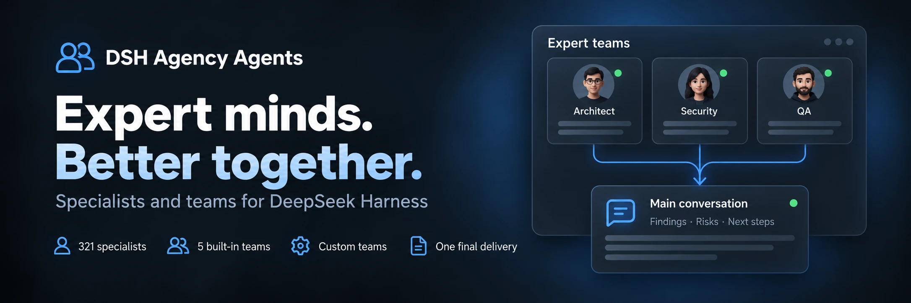

<div align="center">
  
</div>

<div align="center">

  # DSH Agency Agents

  **331 spécialistes · 5 équipes intégrées · Collaboration sur mesure**

  [简体中文](README.zh-CN.md) · [English](README.en.md) · [日本語](README.ja.md) · [Español](README.es.md) · [Français](README.fr.md) · [Deutsch](README.de.md) · [Русский](README.ru.md) · [Português](README.pt.md)

  [Liste des experts](#divisions-d’experts-22-divisions) · [Installation](#installation-rapide) · [Journal des modifications](CHANGELOG.md) · [Apache-2.0](LICENSE)

  [](LICENSE)
  [](#divisions-d’experts-22-divisions)
  [](https://www.npmjs.com/package/@michengai/dsh-agency-agents)
  [](https://www.npmjs.com/package/@michengai/dsh-agency-agents)
  [](https://github.com/MichengAI/dsh-agency-agents)
  [](https://github.com/MichengAI/dsh-agency-agents)

</div>

> **Avertissement** : DSH Agency Agents est un plugin maintenu par la communauté pour DeepSeek Harness (DSH) et n’est pas un produit officiel de DeepSeek AI.

## Aperçu des fonctionnalités

Pour la revue de code, le design, les opérations ou la recherche, choisissez un spécialiste dans DSH pour vous assister avec expertise. 331 experts sont intégrés et prêts à l’emploi après installation.

- **Accès multi-surfaces et affichage large** : Accédez depuis **Paramètres → Experts** ou activez l’entrée latérale permanente pour ouvrir un panneau dédié de 960px centré.
- **Création assistée par IA (Create with AI)** : Création en dialogue avec redirection vers le chat principal et pré-remplissage des prompts. Aperçus Markdown interactifs et confirmation native Ask (Human-in-the-Loop).
- **Actions groupées intelligentes** : Menu compact dans la barre de filtre avec synchronisation dynamique : « Activer filtrés (N) / Désactiver filtrés (M) » et « Tout activer (331) / Tout désactiver » avec exécution atomique.
- **Répertoire complet de 331 experts métier** : Couvre 22 divisions standards (ingénierie, produit, design, marketing, juridique, etc.) avec recherche instantanée.
- **Collaboration d’équipe multi-rôles (Teams)** : 5 équipes expertes intégrées et création de jusqu’à 100 équipes personnalisées en parallèle ou en relais.
- **Invocation rapide dans l’éditeur** : Convoquez des spécialistes ou des équipes avec le déclencheur `@` ou le bouton robot à côté du champ de saisie.
- **Sécurité et contrôle d’entreprise** : Personnalisez l’emplacement d’accès et les suggestions  ; validation stricte d'origine.
- **Compatibilité proxy inverse** : Résolution automatique de l’URL de base (`document.baseURI`) pour fonctionner sans accroc derrière un proxy inverse avec suppression de préfixe.

## Équipes d’experts (Expert Teams)

Gérez les équipes dans « Paramètres → Experts → Équipes d’experts », partageant l’en-tête, les filtres et la recherche. Les 5 équipes couvrent les scénarios suivants :

| Équipe d’experts | Focus d’analyse | Livrables |
| --- | --- | --- |
| Équipe Revue de Produit | Valeur métier, expérience utilisateur, faisabilité technique | Priorités et plan d’action |
| Équipe Revue Technique | Architecture, sécurité, critères d’acceptation | Risques et liste de contrôle |
| Équipe Stratégie de Contenu | Angles éditoriaux, diffusion, vérification des faits | Proposition éditoriale et plan |
| Équipe Diagnostic de Données | Métriques, qualité des données, interprétation business | Conclusions et étapes de validation |
| Équipe Recherche Thématique | Périmètre d’étude, preuves, synthèse | Conclusions documentées et sourcées |

### Configuration et utilisation

1. Utilisez une équipe intégrée ou dupliquez-la pour la modifier. Créez des équipes personnalisées de 2 à 8 membres (jusqu’à 100).
2. Sélectionnez une équipe avec `@` dans la saisie pour insérer automatiquement des exemples de tâches modifiables.
3. Si l’hôte active le service Agent Team, le mode de collaboration natif s’exécute automatiquement.

## Installation rapide

```bash
# Web Profile
dsh plugin --profile web add @michengai/dsh-agency-agents

# Desktop Profile
dsh plugin --profile desktop add @michengai/dsh-agency-agents
```

## Divisions d’experts (22 Divisions)


| Division | Key | Count |
| --- | --- | --- |
| Engineering | `engineering` | 64 |
| Marketing | `marketing` | 27 |
| Design | `design` | 22 |
| Product | `product` | 21 |
| Sales | `sales` | 19 |
| Healthcare | `healthcare` | 18 |
| Finance | `finance` | 16 |
| Specialized | `specialized` | 16 |
| Academic | `academic` | 14 |
| Research | `research` | 14 |
| Legal | `legal` | 13 |
| Support | `support` | 12 |
| Testing | `testing` | 11 |
| Project Management | `project-management` | 11 |
| Game Development | `game-development` | 11 |
| Spatial Computing | `spatial-computing` | 10 |
| Company Leadership | `company` | 9 |
| Human Resources | `hr` | 8 |
| Security | `security` | 8 |
| Supply Chain | `supply-chain` | 8 |
| Paid Media | `paid-media` | 6 |
| GIS | `gis` | 3 |


## License

[Apache-2.0](LICENSE) © [MichengAI](https://github.com/MichengAI)
