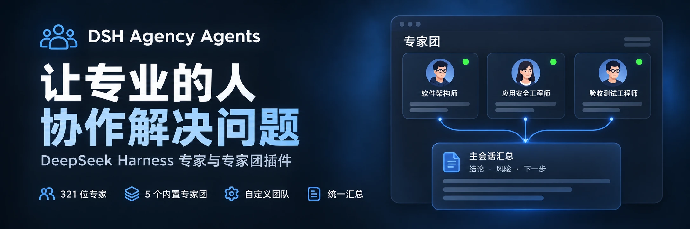

<div align="center">
  
</div>

<div align="center">

  # DSH Agency Agents

  **331名の専門エージェント · 5つの組み込み専門家チーム · カスタム協調**

  [简体中文](README.zh-CN.md) · [English](README.en.md) · [日本語](README.ja.md) · [Español](README.es.md) · [Français](README.fr.md) · [Deutsch](README.de.md) · [Русский](README.ru.md) · [Português](README.pt.md)

  [専門家一覧](#専門家カテゴリー-22-divisions) · [インストール](#クイックインストール) · [更新履歴](CHANGELOG.md) · [Apache-2.0](LICENSE)

  [](LICENSE)
  [](#専門家カテゴリー-22-divisions)
  [](https://www.npmjs.com/package/@michengai/dsh-agency-agents)
  [](https://www.npmjs.com/package/@michengai/dsh-agency-agents)
  [](https://github.com/MichengAI/dsh-agency-agents)
  [](https://github.com/MichengAI/dsh-agency-agents)

</div>

> **免責事項**：DSH Agency Agents はコミュニティによって保守されている DeepSeek Harness（DSH）向けプラグインであり、DeepSeek AI 公式の製品ではありません。

## 機能の概要

コードレビュー、デザイン、運用、研究などのタスクにおいて、DSH で適切な専門家を選択することで、専門的な視点から業務を支援します。331名の専門家を内蔵し、インストール後すぐに利用可能です。

- **マルチサーフェス＆デュアルエントリ**：「設定 → エキスパート」モーダル管理をサポートするほか、プラグイン詳細ページでメインナビゲーションバー常駐の「エキスパート」フルパネル（960px 中央配置、モーダルのスクロール制約を完全解消）を有効化可能。
- **自然言語対話作成（Create with AI）**：新規エキスパートおよびチーム作成で「対話で作成」デュアルエントリをサポート。メインチャットへ自動ジャンプしてプロンプトを事前入力し、対話内で構造化プレビューを出力。複数ターンの微調整後、ホストのネイティブ Ask カード確認を経て編集フォームへ安全に反映（Human-in-the-Loop）。
- **スマート一括操作（Batch Actions）**：管理フィルターバー右側にネイティブなコンパクト一括メニューを搭載。ソース、カテゴリー、ステータス、キーワード検索と動的に連動し、「フィルター結果を有効化 (N) / 無効化 (M)」「すべて有効化 (331) / すべて無効化」を適応提供。二重確認とアトミックスケジューリングで保護。
- **331名の全領域専門家名簿**：エンジニアリング、デザイン、プロダクト、マーケティング、法務、財務など22の標準部門を網羅し、瞬時のプレフィックス検索に対応。
- **専門家チーム（Teams）複数役割協調**：5つの高頻度ビジネスクリティカルチームを内蔵し、最大100個のカスタムチーム作成に対応。タスクの複雑さに応じてリレー推進、並列実行、深層レビューの協調モードを自動選択。
- **チャット入力欄からのクイック呼び出し**：入力欄左側のロボットアイコンからすばやく選択するか、本文に `@` を入力して専門家およびチーム名簿を瞬時に呼び出し、タスク例をシームレスに入力。
- **エンタープライズ構成とセキュリティ防御**：プラグイン詳細ページでエントリ表示位置やスマート推薦を個別に設定可能。静的設定 `updater: false` による更新エンドポイント無効化のプラットフォームロックをサポート。API は同一生成元と Content-Type 防御に完全対応。
- **リバースプロキシ配置の完全互換**：ページのベースアドレス（`document.baseURI`）に対して API エンドポイントを自動解決し、パスプレフィックスを除去するリバースプロキシ環境（`/app/dsh/` など）でも無損失で動作。

## 専門家チーム (Expert Teams)

「設定 → エキスパート → 専門家チーム」でチームを管理します。単一専門家ページと共通のヘッダー、フィルター、検索およびカード操作を提供します。5つの組み込みチームは以下のシナリオをカバーします：

| 専門家チーム | 分析の重点 | 成果物 |
| --- | --- | --- |
| プロダクト方案レビュー団 | 要件の価値、ユーザー体験、技術的実現可能性 | 優先順位とアクションリスト |
| 技術アーキテクチャレビュー団 | アーキテクチャ、セキュリティ、受入境界 | リスクと受入チェックリスト |
| コンテンツ企画レビュー団 | 企画の視点、拡散戦略、ファクトチェック | 企画案とコンテンツ構造 |
| データ分析診断団 | 指標体系、データ品質、ビジネス解釈 | 分析結論と検証ステップ |
| テーマ研究専門家団 | 研究範囲、論拠・証拠、総合判断 | 情報源に基づく研究結論 |

### 構成と使用法

1. 組み込みチームをそのまま利用するか、複製して編集します。2〜8名のメンバーからなるカスタムチームを新規作成することも可能（最大100個まで保存）。
2. 入力欄の `@` メニューでチームを選択すると、タスク要件のサンプルが自動挿入されます。送信前に要件を直接微調整できます。
3. ホストが Agent Team サービスを有効にしている場合、自律的な並列協調モードが自動的に適用されます。

## クイックインストール

```bash
# Web Profile
dsh plugin --profile web add @michengai/dsh-agency-agents

# Desktop Profile
dsh plugin --profile desktop add @michengai/dsh-agency-agents
```

## 専門家カテゴリー (22 Divisions)


| Division | Key | Count |
| --- | --- | --- |
| Engineering | `engineering` | 64 |
| Marketing | `marketing` | 27 |
| Design | `design` | 22 |
| Product | `product` | 21 |
| Sales | `sales` | 19 |
| Healthcare | `healthcare` | 18 |
| Finance | `finance` | 16 |
| Specialized | `specialized` | 16 |
| Academic | `academic` | 14 |
| Research | `research` | 14 |
| Legal | `legal` | 13 |
| Support | `support` | 12 |
| Testing | `testing` | 11 |
| Project Management | `project-management` | 11 |
| Game Development | `game-development` | 11 |
| Spatial Computing | `spatial-computing` | 10 |
| Company Leadership | `company` | 9 |
| Human Resources | `hr` | 8 |
| Security | `security` | 8 |
| Supply Chain | `supply-chain` | 8 |
| Paid Media | `paid-media` | 6 |
| GIS | `gis` | 3 |


## License

[Apache-2.0](LICENSE) © [MichengAI](https://github.com/MichengAI)
