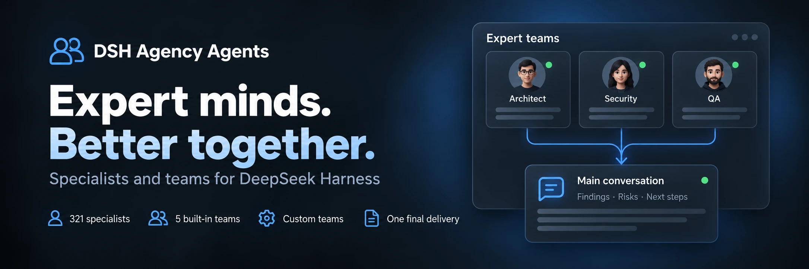

<div align="center">
  
</div>

<div align="center">

  # DSH Agency Agents

  **331 especialistas · 5 equipas integradas · Colaboração personalizada**

  [简体中文](README.zh-CN.md) · [English](README.en.md) · [日本語](README.ja.md) · [Español](README.es.md) · [Français](README.fr.md) · [Deutsch](README.de.md) · [Русский](README.ru.md) · [Português](README.pt.md)

  [Lista de especialistas](#categorias-de-especialistas-22-divisions) · [Instalação](#instalação-rápida) · [Histórico de versões](CHANGELOG.md) · [Apache-2.0](LICENSE)

  [](LICENSE)
  [](#categorias-de-especialistas-22-divisions)
  [](https://www.npmjs.com/package/@michengai/dsh-agency-agents)
  [](https://www.npmjs.com/package/@michengai/dsh-agency-agents)
  [](https://github.com/MichengAI/dsh-agency-agents)
  [](https://github.com/MichengAI/dsh-agency-agents)

</div>

> **Aviso**: O DSH Agency Agents é um plugin mantido pela comunidade para o DeepSeek Harness (DSH), não sendo um produto oficial da DeepSeek AI.

## Visão geral das funcionalidades

Em tarefas de revisão de código, design, operações ou pesquisa, escolha um especialista no DSH para obter suporte com rigor profissional. 331 especialistas integrados e prontos a usar após a instalação.

- **Acesso em múltiplas superfícies e layout amplo**: Faça a gestão em **Definições → Especialistas** ou ative o acesso fixo na barra lateral esquerda com painel dedicado de 960px.
- **Criação assistida por IA (Create with AI)**: Criação por diálogo com salto para o chat principal e preenchimento de prompts. Pré-visualizações em Markdown estruturado e confirmação nativa Ask (Human-in-the-Loop).
- **Ações em lote inteligentes**: Menu compacto na barra de filtros com ligação dinâmica: «Ativar filtrados (N) / Desativar filtrados (M)» e «Ativar todos (331) / Desativar todos», com execução atómica.
- **Catálogo completo com 331 especialistas**: Abrange 22 divisões padrão (engenharia, produto, design, marketing, jurídico, finanças, etc.) com pesquisa rápida.
- **Colaboração de equipas multifuncionais (Teams)**: 5 equipas integradas e suporte para até 100 equipas personalizadas com execução paralela ou em etapas.
- **Convocação rápida no compositor**: Convoque especialistas ou equipas através de `@` ou do botão de robô junto à caixa de entrada.
- **Segurança e controlo empresarial**: Configure locais de entrada e sugestões inteligentes; suporte a `updater: false` para desativar endpoints de atualização com bloqueio estrito de plataforma; validação de origem.
- **Compatibilidade com proxies inversos**: Resolução automática do endereço base (`document.baseURI`) para funcionamento perfeito atrás de proxies que removem prefixos.

## Equipas de especialistas (Expert Teams)

Faça a gestão de equipas em «Definições → Especialistas → Equipas de especialistas». As 5 equipas cobrem os seguintes cenários:

| Equipa de especialistas | Foco da análise | Livrables |
| --- | --- | --- |
| Equipa de Revisão de Produto | Valor dos requisitos, experiência do utilizador, viabilidade técnica | Prioridades e plano de ação |
| Equipa de Revisão Técnica | Arquitetura, segurança, critérios de aceitação | Riscos e lista de verificação |
| Equipa de Planeamento de Conteúdos | Ângulo editorial, estratégia de divulgação, verificação de factos | Proposta editorial e estrutura |
| Equipa de Diagnóstico e Análise de Dados | Métricas, qualidade dos dados, interpretação de negócio | Conclusões e passos de validação |
| Equipa de Pesquisa Temática | Âmbito do estudo, evidências, julgamento sintético | Conclusões fundamentadas com fontes |

### Configuração e utilização

1. Utilize uma equipa integrada diretamente ou copie-a para personalizar. Crie equipas personalizadas com 2 a 8 membros (até 100 guardadas).
2. Selecione uma equipa com `@` na caixa de entrada para inserir automaticamente exemplos de tarefas antes de enviar.
3. Se o anfitrião tiver o serviço Agent Team ativado, o modo nativo de colaboração paralela será aplicado automaticamente.

## Instalação rápida

```bash
# Web Profile
dsh plugin --profile web add @michengai/dsh-agency-agents

# Desktop Profile
dsh plugin --profile desktop add @michengai/dsh-agency-agents
```

## Categorias de especialistas (22 Divisions)


| Division | Key | Count |
| --- | --- | --- |
| Engineering | `engineering` | 64 |
| Marketing | `marketing` | 27 |
| Design | `design` | 22 |
| Product | `product` | 21 |
| Sales | `sales` | 19 |
| Healthcare | `healthcare` | 18 |
| Finance | `finance` | 16 |
| Specialized | `specialized` | 16 |
| Academic | `academic` | 14 |
| Research | `research` | 14 |
| Legal | `legal` | 13 |
| Support | `support` | 12 |
| Testing | `testing` | 11 |
| Project Management | `project-management` | 11 |
| Game Development | `game-development` | 11 |
| Spatial Computing | `spatial-computing` | 10 |
| Company Leadership | `company` | 9 |
| Human Resources | `hr` | 8 |
| Security | `security` | 8 |
| Supply Chain | `supply-chain` | 8 |
| Paid Media | `paid-media` | 6 |
| GIS | `gis` | 3 |


## License

[Apache-2.0](LICENSE) © [MichengAI](https://github.com/MichengAI)
