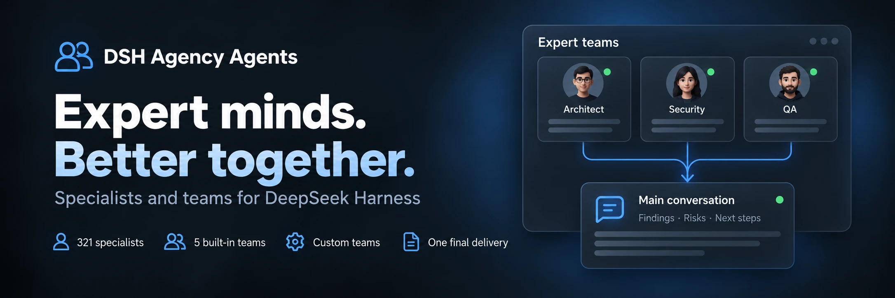

<div align="center">
  
</div>

<div align="center">

  # DSH Agency Agents

  **331 профильный агент · 5 встроенных команд · Пользовательская кооперация**

  [简体中文](README.zh-CN.md) · [English](README.en.md) · [日本語](README.ja.md) · [Español](README.es.md) · [Français](README.fr.md) · [Deutsch](README.de.md) · [Русский](README.ru.md) · [Português](README.pt.md)

  [Список экспертов](#категории-экспертов-22-divisions) · [Установка](#быстрая-установка) · [История изменений](CHANGELOG.md) · [Apache-2.0](LICENSE)

  [](LICENSE)
  [](#категории-экспертов-22-divisions)
  [](https://www.npmjs.com/package/@michengai/dsh-agency-agents)
  [](https://www.npmjs.com/package/@michengai/dsh-agency-agents)
  [](https://github.com/MichengAI/dsh-agency-agents)
  [](https://github.com/MichengAI/dsh-agency-agents)

</div>

> **Отказ от ответственности**: DSH Agency Agents — это плагин для DeepSeek Harness (DSH), поддерживаемый сообществом, и не является официальным продуктом DeepSeek AI.

## Обзор возможностей

При решении задач код-ревью, дизайна, операций или исследований выберите подходящего эксперта в DSH для профессиональной помощи. Встроено 331 экспертов, готовых к работе сразу после установки.

- **Мультиповерхностный доступ и широкий макет**: Управляйте в **Настройки → Эксперты** или включите пункт в левой боковой панели для открытия в окне шириной 960px без ограничений прокрутки.
- **Создание в диалоге с ИИ (Create with AI)**: Создание новых экспертов и команд через диалог с автоматическим переходом в чат и предзаполнением промптов. Структурированное превью и подтверждение через карточку Ask (Human-in-the-Loop).
- **Умные пакетные действия (Batch Actions)**: Компактное меню в панели фильтров: «Включить отфильтрованные (N) / Отключить отфильтрованные (M)» и «Включить все (331) / Отключить все» с защитой подтверждением.
- **Полный каталог из 331 отраслевого эксперта**: 22 стандартных направления (разработка, продукт, дизайн, маркетинг, юриспруденция и т. д.) с мгновенным поиском по префиксу.
- **Многоролевая кооперация команд (Teams)**: 5 встроенных профильных команд и поддержка до 100 пользовательских команд с параллельной или последовательной работой.
- **Быстрый вызов в строке ввода**: Вызывайте экспертов и команды через триггер `@` или кнопку робота рядом с полем ввода с автозаполнением примеров задач.
- **Корпоративный контроль и безопасность**: Настройка точек входа и умных подсказок; поддержка `updater: false` для отключения эндпоинтов обновления в режиме только для чтения на уровне платформы; защита Same-Origin.
- **Совместимость с обратными прокси**: Автоматическое вычисление базового адреса (`document.baseURI`) для корректной работы за прокси с удалением префиксов путей.

## Команды экспертов (Expert Teams)

Управляйте командами в меню «Настройки → Эксперты → Команды экспертов». 5 встроенных команд решают ключевые сценарии:

| Команда экспертов | Фокус анализа | Результаты |
| --- | --- | --- |
| Команда ревью продукта | Ценность требований, UX, техническая реализуемость | Приоритеты и план действий |
| Команда технического ревью | Архитектура, безопасность, границы приемки | Риски и чек-лист приемки |
| Команда контент-планирования | Углы подачи, стратегия дистрибуции, фактчекинг | Контент-план и структура |
| Команда анализа данных | Метрики, качество данных, бизнес-интерпретация | Выводы и шаги валидации |
| Команда тематических исследований | Границы исследования, доказательства, синтез | Обоснованные выводы с источниками |

### Настройка и использование

1. Используйте встроенные команды или копируйте их для кастомизации. Создавайте свои команды от 2 до 8 участников (до 100 команд).
2. Выберите команду через `@` в поле ввода для автоматической вставки примера задачи перед отправкой.
3. Если хост поддерживает Agent Team, автоматически задействуется нативная параллельная командная координация.

## Быстрая установка

```bash
# Web Profile
dsh plugin --profile web add @michengai/dsh-agency-agents

# Desktop Profile
dsh plugin --profile desktop add @michengai/dsh-agency-agents
```

## Категории экспертов (22 Divisions)


| Division | Key | Count |
| --- | --- | --- |
| Engineering | `engineering` | 64 |
| Marketing | `marketing` | 27 |
| Design | `design` | 22 |
| Product | `product` | 21 |
| Sales | `sales` | 19 |
| Healthcare | `healthcare` | 18 |
| Finance | `finance` | 16 |
| Specialized | `specialized` | 16 |
| Academic | `academic` | 14 |
| Research | `research` | 14 |
| Legal | `legal` | 13 |
| Support | `support` | 12 |
| Testing | `testing` | 11 |
| Project Management | `project-management` | 11 |
| Game Development | `game-development` | 11 |
| Spatial Computing | `spatial-computing` | 10 |
| Company Leadership | `company` | 9 |
| Human Resources | `hr` | 8 |
| Security | `security` | 8 |
| Supply Chain | `supply-chain` | 8 |
| Paid Media | `paid-media` | 6 |
| GIS | `gis` | 3 |


## License

[Apache-2.0](LICENSE) © [MichengAI](https://github.com/MichengAI)
